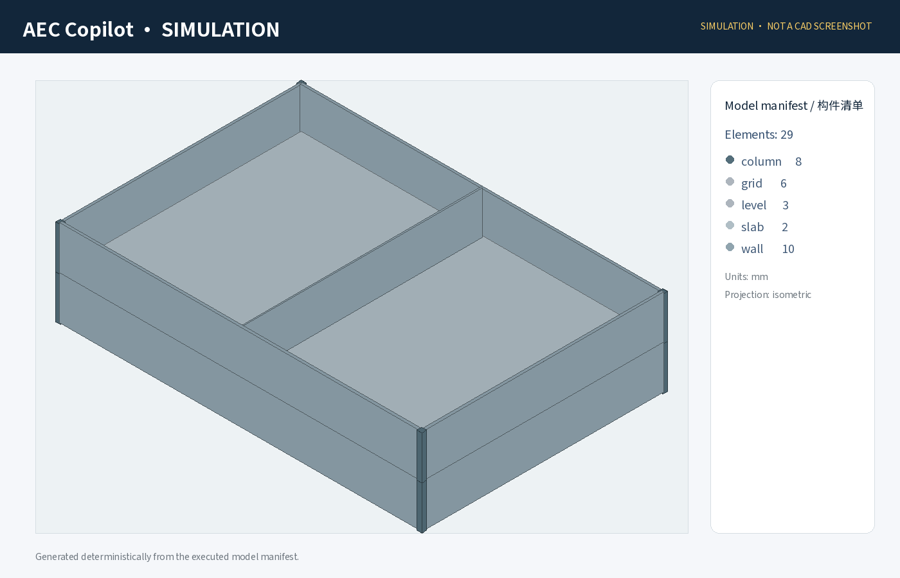

# 蓝图智匠 · AEC Copilot

**自然语言 → 建模 DSL → 原子事务 → 截图 → 模型清单校验 → 最多三轮重试 → Excel / PDF。**

这是一份**完整、可运行的项目源码**，不是只有架构图的演示。当前交付已经在 Linux 沙箱中验证了模拟后端、统一 MCP 服务、CLI、HTTP API、Web 构建和报告导出。**真实 Revit / AutoCAD / SolidWorks 实机适配尚未联调**，运行界面和报告均明确标注 `SIMULATION`，不把模拟结果冒充为工业软件验收。



## 已实现

| 模块 | 当前实现 |
|---|---|
| 统一引擎契约 | `revit_*` / `acad_*` / `sw_*`，统一 mm、五类错误码、工具目录 |
| 建模 DSL | Pydantic + JSON Schema，中文确定性规划器，可选受约束 LLM JSON 回退 |
| 编译与事务 | 意图展开为原子调用；preview / commit / rollback；失败最终结果不保留已回滚构件 |
| 校验与重试 | 不可变预期清单逐字段比对；截图；最多三轮；可选 VLM 复核接口 |
| 三引擎模拟后端 | Revit 墙/柱/板/门窗/轴网/标高；AutoCAD 多段线；SolidWorks 零件/装配 |
| 真实 MCP 适配层 | stdio JSON-RPC、工具映射、强制原生事务钩子、只读清单与原生截图接口 |
| 审图 | 命名、几何、墙厚、门窗尺寸与宿主、标高、轴网、柱板规则；项目规则报告 |
| 报告 | 中文 PDF、Excel 构件明细、运行 JSON、评测 Excel / PDF / JSON |
| 知识层 | 本地 JSONL few-shot 检索；LightRAG HTTP 只读适配器 |
| 交付层 | Next.js 16 + React 19 + three.js 控制台；Python 标准库 HTTP API |
| 评测 | 50 例建模、20 例预埋缺陷、确定性重放、三轮故障注入、30 项自动测试 |

## 1. 快速开始

要求：Python 3.10+；Web 控制台另需 Node.js 20.9+。

### Windows PowerShell

```powershell
cd aec-copilot
py -m venv .venv
.\.venv\Scripts\Activate.ps1
python -m pip install -e ".[all]"

# 中文 PDF 需要单字重 CJK TTF/OTF。若系统有 simhei.ttf，可直接使用：
$env:REPORTLAB_CJK_REGULAR_FONT = "C:\Windows\Fonts\simhei.ttf"
$env:REPORTLAB_CJK_BOLD_FONT = "C:\Windows\Fonts\simhei.ttf"

# 先预览，不写任何模型
aec preview "在0,0画一面6m长的墙"

# 完整执行：默认 simulation，不写入本机 Revit
aec run "生成一栋30m×20m的两层小楼，层高3.6m，外墙200mm，中间加一道隔墙，四个角放柱子"
```

### Linux / macOS

```bash
cd aec-copilot
python -m venv .venv
source .venv/bin/activate
python -m pip install -e '.[all]'

# PDF 字体路径按本机调整；沙箱验证使用 NotoSansSC。
export REPORTLAB_CJK_REGULAR_FONT=/path/to/NotoSansSC-Regular.ttf
export REPORTLAB_CJK_BOLD_FONT=/path/to/NotoSansSC-Bold.ttf

aec run "生成一个6m×4m的房间，层高3.6m，墙厚200mm，包含楼板"
```

每次运行会生成一个独立目录：

```text
runs/<run-id>/
├─ plan.json               # 可重放的原始 DSL 与修复轨迹
├─ elements.json           # 最终模型清单；失败回滚后为空
├─ run.json                # 每轮耗时、差异、Token、最终状态
├─ attempt-1.png           # 模拟渲染；不是 Revit 原生截图
├─ model-schedule.xlsx     # 构件明细与运行摘要
└─ modeling-report.pdf     # 中文建模报告
```

更多命令：

```bash
# 执行已有 DSL；真实后端也必须先提供本机映射配置
aec run --plan path/to/plan.json

# 项目规则审图；存在 error 级问题时 CLI 返回 1
aec audit examples/model-with-defects.json --output runs/audit

# 统一 MCP stdio server（模拟后端）
aec mcp

# 重跑完整模拟基准
python eval/run_eval.py eval/results

# 测试
pytest
```

## 2. Web 控制台

终端一：

```bash
aec serve --host 127.0.0.1 --port 8000
```

终端二：

```bash
cd apps/web
npm ci
cp .env.example .env.local   # Windows 可手动复制
npm run dev
```

打开 `http://localhost:3000`。支持指令预览、模拟执行、三维旋转缩放、执行轨迹、项目规则审图和报告下载。生产构建：

```bash
npm run typecheck
npm run build
npm run start
```

HTTP API 默认只绑定 `127.0.0.1`，且 Web 路径只开放模拟后端；不要未经认证直接暴露到公网。

## 3. MCP 客户端配置

```json
{
  "mcpServers": {
    "aec-copilot": {
      "command": "/absolute/path/to/.venv/bin/aec",
      "args": ["mcp"]
    }
  }
}
```

Windows 将 `command` 改为虚拟环境中 `aec.exe` 的绝对路径。`tools/list` 当前暴露 15 个工具；同一 MCP 会话可分别调用 `revit_create_level`、`acad_draw_polyline` 和 `sw_create_part`。

## 4. 本次实际验证结果

以下均为**合成夹具 + 模拟引擎**，不是实机性能或泛化能力声明：

| 检查 | 实测结果 |
|---|---:|
| Python 自动测试 | 30 / 30 通过 |
| 建模评测一次通过 | 50 / 50（100%） |
| 建模评测三轮内通过 | 50 / 50（100%） |
| 预埋缺陷预期规则命中 | 20 / 20（100%） |
| 平均端到端耗时 | 113.573 ms（该次沙箱运行） |
| 确定性重放 | 通过 |
| 故障注入 | 第 2 / 3 轮恢复；持续故障三轮后模型为空 |
| MCP 实际进程联调 | 初始化、15 工具枚举、三引擎同会话调用通过 |
| HTTP API 联调 | 建模、审图、PNG / XLSX / PDF 下载通过 |
| Web | TypeScript、Next.js 生产构建及生产页面启动通过；生产依赖审计 0 漏洞 |
| LLM / VLM Token | 0（本次未调用外部模型，不是 10M+） |

机器可读原始结果在 `eval/results/evaluation.json`、`audit-results.json`、`evaluation.xlsx` 和 `evaluation.pdf`。最终两层小楼的完整运行目录随源码附在 `examples/final-demo/`，包含 DSL、模型清单、运行轨迹、PNG、Excel 和 PDF。

## 5. 真实软件接入与尚未完成项

真实引擎不是开关一拨就已验收。必须在你 Windows 本机复制工程文件、配置工具映射并逐项验证：

```bash
aec run "在0,0画一面6m长的墙" \
  --backend mcp --mcp-config path/to/mcp-config.json
```

缺少 `begin / commit / rollback` 任一原生事务钩子时，真实写入会被拒绝。详见 [本机联调清单](docs/local-integration.md)。

**当前明确未完成：**真实三软件实机验证、外部 VLM 实际调用、完整 LightRAG 部署与 RAG 提升对照实验、LLM 语义审图、剪映 60 秒视频及 GitHub 发布。当前自动纠错是“保留原始需求、回滚并重放 canonical DSL”的有界重试，能恢复已测试的瞬态漏构件，不等同于任意语义错误的自动修复。审图阈值是项目演示规则，不构成法定规范合规或结构安全结论。

## 6. 文档导航

- [系统架构与事务边界](docs/architecture.md)
- [统一工具目录](docs/tool-catalog.md)
- [真实软件本机联调](docs/local-integration.md)
- [LLM / VLM 配置](docs/llm-vlm.md)
- [知识库](docs/knowledge.md)
- [评测口径与局限](docs/evaluation.md)
- [HTTP API](docs/api.md)
- [交付清单](DELIVERY.md)

---

## English

AEC Copilot is a runnable natural-language modeling orchestration project with a validated JSON DSL, deterministic compilation, atomic transactions, manifest verification, bounded retries, simulation backends for Revit/AutoCAD/SolidWorks contracts, a unified MCP stdio server, a Next.js/three.js console, project-rule audits, and PDF/Excel reports.

**Verification boundary:** all 50 modeling and 20 seeded-defect benchmarks ran on the deterministic simulator. The live Revit, AutoCAD and SolidWorks adapters require site-specific mappings and workstation validation; no live CAD/BIM success is claimed. External LLM/VLM calls, the full LightRAG uplift experiment, semantic LLM audit, video generation and GitHub publication remain unexecuted.

```bash
python -m pip install -e '.[all]'
aec preview "在0,0画一面6m长的墙"
aec run "生成一个6m×4m的房间，包含楼板"
pytest
python eval/run_eval.py eval/results
```

Set `REPORTLAB_CJK_REGULAR_FONT` and `REPORTLAB_CJK_BOLD_FONT` to single-face CJK `.ttf`/`.otf` fonts for Chinese PDF export. See the documents above for MCP integration, API startup, environment variables and benchmark methodology.
