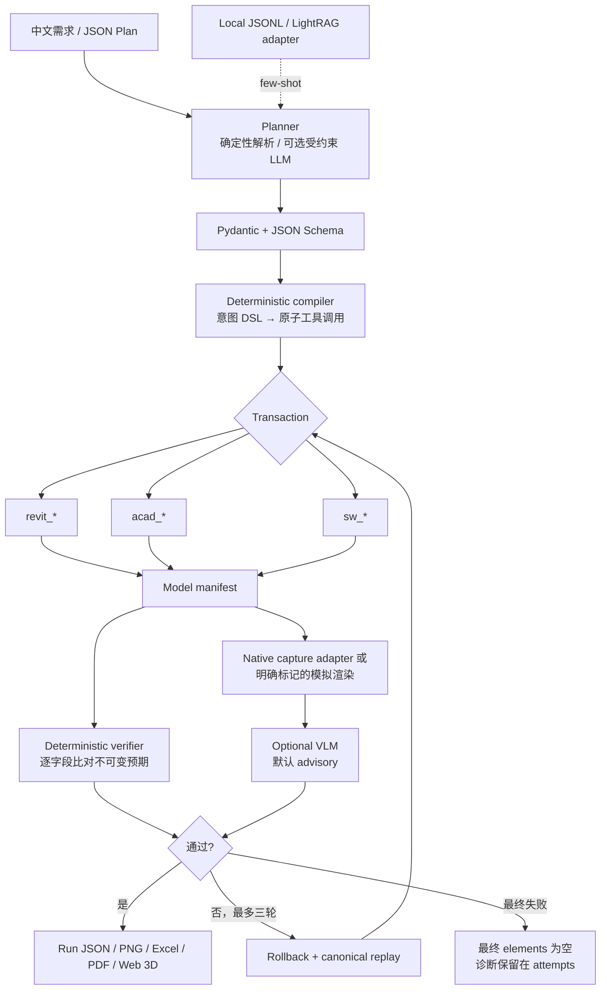

# 系统架构与关键边界

## 架构



## 为什么使用 DSL 中间层

LLM 只允许产生受约束的意图或原子 JSON，不直接拼接插件 API。编译器负责展开房间、框架和小楼，并在执行前检查操作白名单、跨引擎约束、ID 唯一性、门窗宿主和长度单位。收益是可静态校验、可重放、可生成 golden manifest、可比较不同规划器；代价是支持范围受 DSL 表达能力限制。

## 事务边界

- 所有写操作都在同一个 `Engine.transaction()` 中。
- 正常退出事务才 commit；执行异常或校验失败都会 rollback。
- 每轮失败不会放宽原始尺寸或数量要求，也不会把实际错误反向写入 golden。
- 最终失败时 `RunResult.elements` 与 `elements.json` 均为空；失败前的诊断仍在 `attempts[].verification.differences`。
- 模拟引擎通过深拷贝快照实现回滚；真实 MCP 适配器必须配置原生 `begin / commit / rollback`，否则拒绝写入。
- 真实工程必须先复制到测试副本；通用适配器无法替你证明某个第三方 Revit 插件的回滚覆盖所有副作用。

## 校验语义

`verifier.compare_manifest()` 对预期清单中的每个公共字段逐项比较：

- 数值容差为 `0.01 mm`，并使用相对容差 `1e-7`；
- 列表长度与顺序必须一致；
- 缺构件、缺字段、值不符分别形成结构化差异；
- 预期清单不会被实际模型修改；
- VLM 默认仅 advisory，截图判断不能推翻几何清单。只有在本机完成假阳性评测后才应启用 enforce；
- 当前 retry 是 canonical DSL 的回滚重放，不是任意自然语言语义修复器。

## 模块对应

```text
src/aec_copilot/
├─ models.py          # Plan、ToolCall、RunResult、AuditReport
├─ units.py           # mm/cm/m/毫米/厘米/米 → mm
├─ errors.py          # E_UNIT/E_GEOM/E_NOT_FOUND/E_CONSTRAINT/E_ENGINE_DOWN
├─ planner.py         # 中文规划器 + OpenAI-compatible JSON 回退
├─ compiler.py        # 意图展开与执行前约束
├─ runner.py          # 最多三轮编排、耗时与 Token 记录
├─ verifier.py        # 清单比对 + 可选 VLM
├─ audit.py           # 项目规则审图
├─ reports.py         # PDF/Excel
├─ knowledge.py       # 本地 few-shot + LightRAG HTTP 适配
├─ mcp_server.py      # 统一 MCP stdio server
├─ server.py          # 本地 HTTP API
└─ engines/
   ├─ base.py         # Engine / Transaction SPI
   ├─ sim.py          # 可复现模拟实现
   ├─ mcp.py          # 真实 stdio MCP 映射层
   └─ registry.py     # 后端选择
```

## 渲染与 Web 预览的边界

沙箱 PNG 由 Pillow 根据模型清单绘制，带 `SIMULATION · NOT A CAD SCREENSHOT` 标识。Web three.js 也是清单的轻量可视化，不是 BIM 内核：门窗以彩色构件显示，不执行真实布尔开洞；柱、板和墙用于方案验证与交互演示，不用于施工出图。真实引擎可配置 `capture_tool` 返回原生 PNG。
